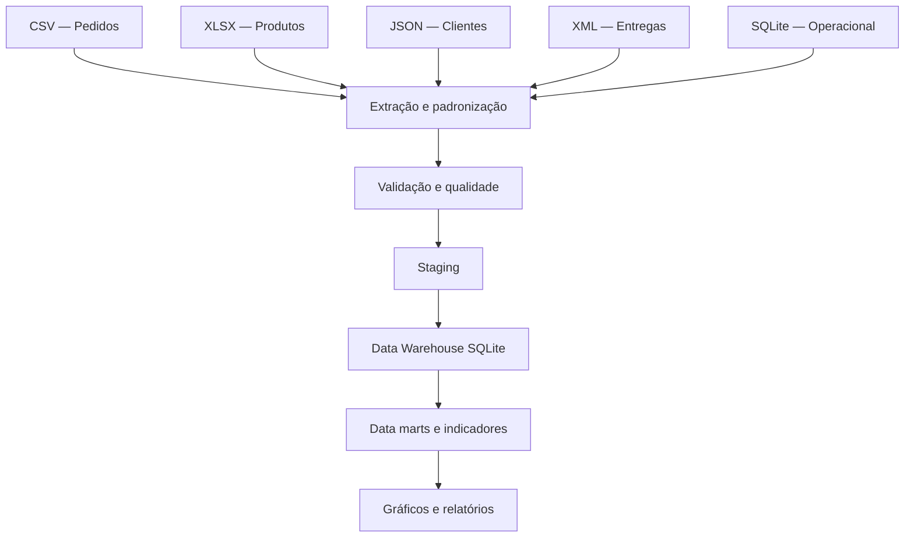
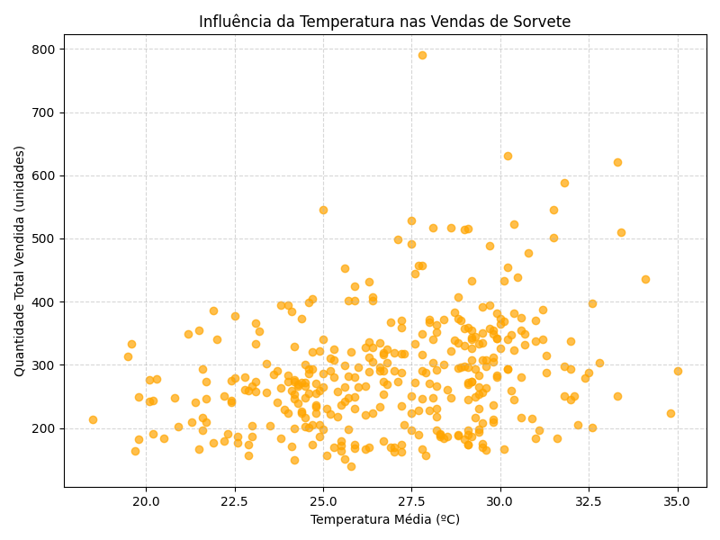
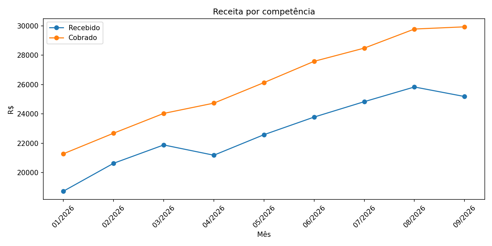
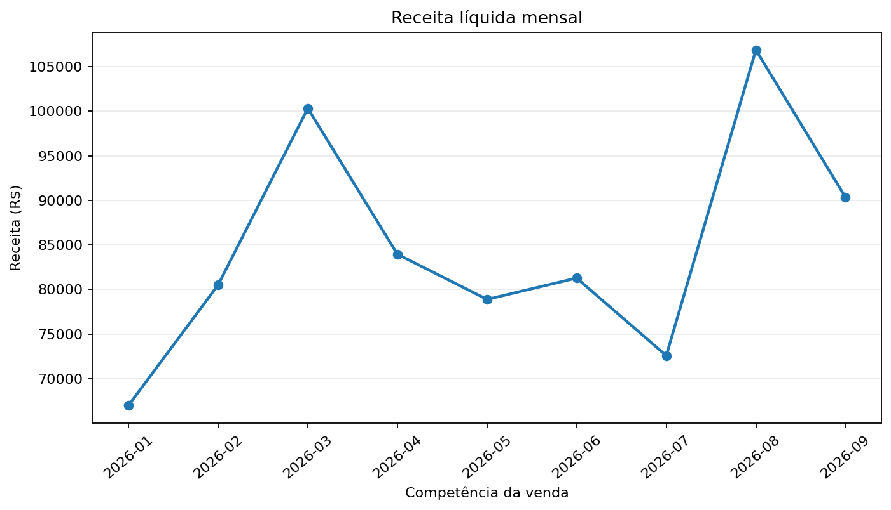

# Análise de Dados com Python 📊

Repositório de estudos práticos em **Análise de Dados, SQL e Engenharia de Dados**. Os projetos exploram diferentes formatos de armazenamento e problemas de negócio, desde análises exploratórias com Pandas até a construção de um **Data Warehouse multifonte**.

## Projetos

| Projeto | Fonte de dados | Objetivo e técnicas | Acessar |
|:--|:--|:--|:--|
| **01 — Sorveteria** | CSV | Vendas por sabor, sazonalidade, clima, `groupby` e gráficos | [Ver projeto](./sorveteria/) |
| **02 — Streaming** | CSV | Churn, retenção, planos, uso diário e indicadores | [Ver projeto](./streaming/) |
| **03 — Livraria** | JSON | Receita, margem estimada, estoque e avaliações | [Ver projeto](./livraria/) |
| **04 — Academia Analytics** | XLSX | Múltiplas abas, `merge`, inadimplência e ticket médio | [Ver projeto](./academia/) |
| **05 — Atendimento ao Cliente** | JSON aninhado | `json_normalize`, `explode`, tempo de resolução e suporte | [Ver projeto](./atendimento/) |
| **06 — Notas Fiscais** | XML | ElementTree, XPath, namespaces e consolidação documental | [Ver projeto](./notas_fiscais/) |
| **07 — E-commerce** | SQLite | Banco relacional, `JOIN`, KPIs de vendas e SQL analítico | [Ver projeto](./ecommerce/) |
| **08 — Retail Data Warehouse** | CSV · XLSX · JSON · XML · SQLite | Integração ETL, staging, modelo estrela, dimensões, fatos e data marts | [Ver projeto](./data_warehouse/) |

## Destaque — Retail Data Warehouse

O projeto integrador reúne cinco origens de dados em um **warehouse analítico SQLite**, com verificações de qualidade e integridade, modelagem dimensional e exportação de relatórios e gráficos.



**Conceitos aplicados:** ETL, integridade referencial, granularidade dos fatos, dimensões, consultas SQL e conciliação de métricas.

[Explorar o projeto completo](./data_warehouse/)

## Visualizações

| Sorveteria | Streaming |
|:--:|:--:|
|  |  |
| Academia | E-commerce |
|  |  |

## Ferramentas estudadas

**Linguagem:** Python 3.11+  
**Manipulação e análise:** Pandas  
**Visualização:** Matplotlib, Seaborn  
**Dados e integração:** CSV, Excel (OpenPyXL), JSON, XML e SQLite  
**Qualidade e testes:** validação de dados, Pytest e SQL

## Executando os projetos

Cada pasta corresponde a um projeto **independente**, com seu próprio `main.py`, dependências e instruções no `README.md` correspondente. No Windows (PowerShell), por exemplo:

```powershell
cd academia
py -m venv .venv
.\.venv\Scripts\python.exe -m pip install -r requirements.txt
.\.venv\Scripts\python.exe main.py
.\.venv\Scripts\python.exe -m pytest -q
```

Para analisar outro caso, entre na pasta desejada e utilize as instruções do seu README. Os primeiros projetos têm estrutura mais simples e não incluem uma suíte automatizada de testes.

## Organização

```text
python-data-analytics/
├── sorveteria/         # CSV — vendas
├── streaming/          # CSV — churn
├── livraria/           # JSON — vendas e estoque
├── academia/           # Excel — gestão financeira
├── atendimento/        # JSON aninhado — suporte
├── notas_fiscais/      # XML — documentos comerciais
├── ecommerce/          # SQLite — inteligência comercial
├── data_warehouse/     # Integração multifonte + modelo estrela
├── assets/previews/    # Gráficos ilustrativos dos estudos
├── .gitignore
└── README.md
```

## Escopo dos dados

Este repositório utiliza bases **fictícias, demonstrativas ou de estudo**; não são informações de clientes reais. Os documentos XML do projeto fiscal são **didáticos e não equivalem ao leiaute oficial da NF-e**. As métricas apresentadas devem ser interpretadas dentro das hipóteses e dos recortes de cada estudo.

O repositório contém os arquivos de entrada necessários para reprodução dos exercícios. Dados processados, caches, ambientes locais e relatórios de execução são gerados novamente ao rodar os projetos.

