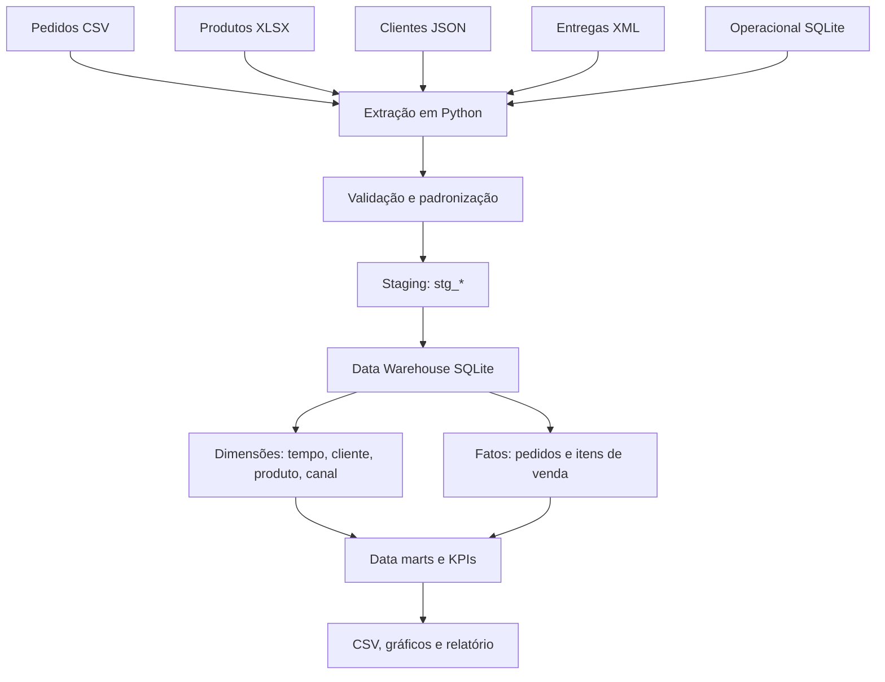

# Retail Data Warehouse — Integração de cinco formatos

Projeto de engenharia e análise de dados com fontes **CSV, XLSX, JSON, XML e SQLite**, pipeline ETL, camada de staging, Data Warehouse relacional em SQLite, modelo estrela, data marts e gráficos.

> Dados integralmente sintéticos. Nenhum cliente, empresa ou pagamento representa pessoa ou operação real.

## Arquitetura



**Grãos distintos**: uma linha por pedido em `fato_pedidos` e uma linha por item em `fato_itens_venda`. Esse desenho evita duplicar frete e número de pedidos em agregações.

## Pré-requisitos

- Windows/Linux/macOS, Python 3.11+
- Não é necessário instalar um servidor de banco de dados: SQLite está embutido no Python.

## Execução (PowerShell)

```powershell
py -m venv .venv
.\.venv\Scripts\python.exe -m pip install -r requirements.txt
.\.venv\Scripts\python.exe main.py
.\.venv\Scripts\python.exe -m pytest -v
```

Execute os comandos na raiz do projeto. Se estiver usando Linux/macOS, ative o ambiente com `source .venv/bin/activate` e use `python main.py` / `python -m pytest -v`.

## Fontes e reprodutibilidade

As cinco fontes já estão incluídas em `data/raw/`. `scripts/gerar_base.py` gera novamente CSV, JSON, XML e o SQLite operacional usando um catálogo fixo obtido de `catalogo_produtos.xlsx` e uma semente determinística. **Não sobrescreve a planilha Excel**: ela é a fonte de cadastro de produtos, que pode ser editada separadamente.

```powershell
.\.venv\Scripts\python.exe scripts/gerar_base.py
.\.venv\Scripts\python.exe main.py
```

> Executar o gerador sobrescreve `pedidos.csv`, `clientes.json`, `entregas.xml` e `operacional.db`. O warehouse anterior é substituído somente depois de um novo processamento consistente.

## Organização

```
project/
├── data/
│   ├── raw/                 # CSV, XLSX, JSON, XML, SQLite operacional
│   └── processed/           # data marts exportados como CSV
├── src/
│   ├── coleta.py            # extratores específicos por formato
│   ├── qualidade.py         # esquema e regras de integridade
│   ├── warehouse.py         # carga transacional do DW
│   ├── analysis.py          # consultas analíticas
│   ├── visualization.py     # gráficos
│   └── report.py            # relatório gerencial
├── sql/
│   ├── schema.sql           # dimensões e fatos
│   ├── carga_dimensional.sql
│   └── exemplos_consultas.sql
├── scripts/gerar_base.py
├── tests/
├── docs/dicionario_dados.md
├── outputs/graficos/
├── outputs/relatorios/
├── warehouse/retail_dw.db  # saída final do ETL
├── main.py
└── requirements.txt
```

## Consultas e análises

- Receita mensal, por categoria, canal e estado.
- Pedidos concluídos e cancelados; ticket médio.
- Produtos e clientes com maior faturamento.
- Prazo médio de entrega e custo logístico.
- Margem de contribuição simplificada.
- Reconciliação: faturamento da tabela de itens = total recebido da tabela de pedidos.

Abra `sql/exemplos_consultas.sql` para praticar agregações e `JOIN` no banco analítico, e `docs/dicionario_dados.md` para conhecer todas as tabelas e regras.

## Garantias e limites

- Validações de esquema, chaves, tipos, integridade referencial, valores monetários e reconciliação.
- Banco analítico criado temporariamente e publicado com substituição ao final, reduzindo risco de deixar uma carga parcial.
- Cada execução reconstrói o snapshot da base completa: não é carga incremental nem solução com SCD 2.
- SQLite é adequado para um laboratório local; evolução natural para volumes maiores: DuckDB ou PostgreSQL + orquestração e ingestão incremental.
