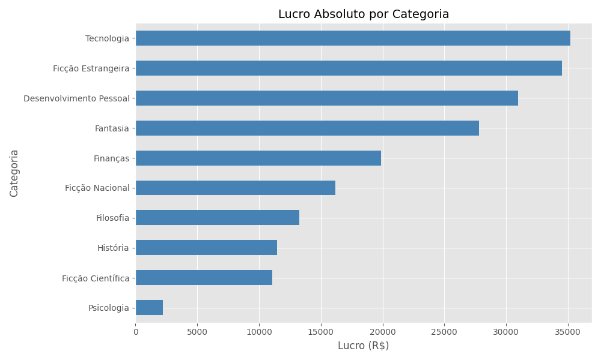

# Análise de vendas e estoque de livraria — JSON

Projeto de análise de catálogo comercial armazenado em JSON, com cálculo de receita, custos, lucro estimado, risco de estoque baixo e relação entre avaliações e unidades vendidas.

## Ferramentas

Python, JSON, Pandas, Matplotlib e Seaborn.

## Base e fluxo

- `livraria_vendas.json`: catálogo e vendas, incluindo listas de avaliações por livro.
- `coleta.py`: leitura de JSON e conversão para DataFrame.
- `limpar.py`: validações e preparação.
- `tratar.py`: cálculo de métricas derivadas.
- `analysis.py`: consolidação de KPIs.
- `visualization.py`: gráficos.

## Questões investigadas

1. Quais categorias apresentam maior receita e margem estimada?
2. Quais títulos possuem estoque crítico?
3. Existe relação entre avaliação média e número de vendas?

## Executar

```powershell
py -m pip install -r requirements.txt
py main.py
```

## Visualização


