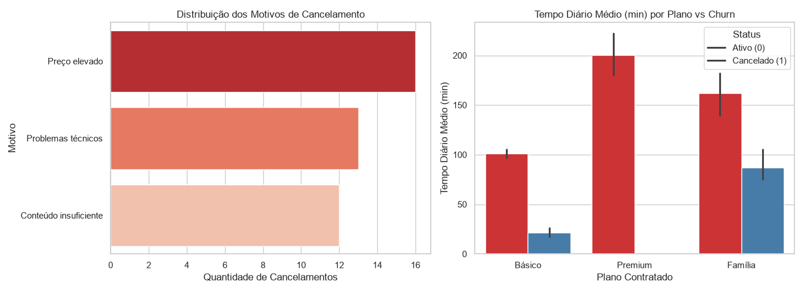

# Análise de churn em streaming — CSV

Projeto exploratório para avaliar cancelamento de assinaturas, padrões de uso, atendimento de suporte e diferenças de churn entre planos.

## Ferramentas

Python, Pandas, Matplotlib e Seaborn.

## Base e fluxo

- `data/streaming_churn.csv`: amostra de assinantes.
- `src/coleta.py`: leitura do CSV.
- `src/limpar.py`: diagnóstico de qualidade.
- `src/tratar.py`: preparação para análise.
- `src/analysis.py`: KPIs e agregações de cancelamento.
- `src/visualization.py`: gráficos.

## Questões investigadas

1. Qual é a taxa de churn geral e por plano?
2. Como o uso diário difere entre clientes retidos e cancelados?
3. Quais são os motivos de cancelamento mais frequentes?

## Executar

```powershell
py -m pip install -r requirements.txt
py main.py
```

Nota: este é um estudo exploratório de uma amostra. As associações observadas não demonstram causalidade.

## Visualização


